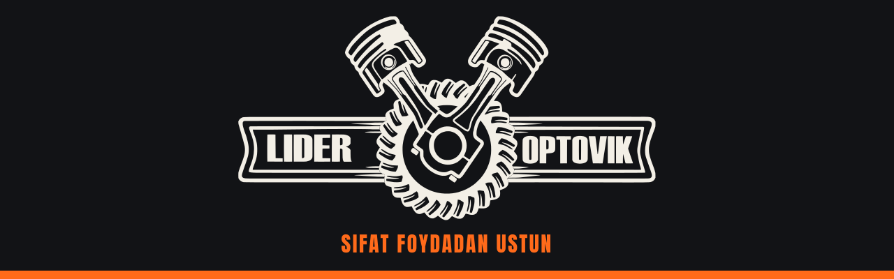

  

  
  
  
  

### 🇺🇿 Biz haqimizda

**Lider Optovik** — Samarqanddagi avtotovarlar do‘konlari tarmog‘i. Ulgurji va chakana savdo, yetkazib berish bor.

### 🇷🇺 О нас

**Lider Optovik** — сеть магазинов автотоваров в Самарканде. Опт и розница, есть доставка.

| | Товары · Mahsulotlar |
|---|---|
| 🔊 | Автозвук: сабвуферы, усилители, процессоры · Avtozvuk |
| 🧰 | Аксессуары: полики, сигналы · Aksessuarlar |
| 🔩 | Ходовая для Damas и других авто · Yurish qismi |
| 🔋 | Аккумуляторы · Akkumulyatorlar |

### 📍 Do‘konlar · Магазины

| Do‘kon · Магазин | Telefon · Телефон |
|---|---|
| Kaftarxona | [+998 55 705-44-41](tel:+998557054441) |
| Makaronka | [+998 55 705-44-42](tel:+998557054442) |
| Panjob | [+998 55 705-44-43](tel:+998557054443) |

Manzillar · Адреса: [t.me/lideroptovikmanzil](https://t.me/lideroptovikmanzil) · Aloqa · Связь: [@lider_optovik](https://t.me/lider_optovik)
